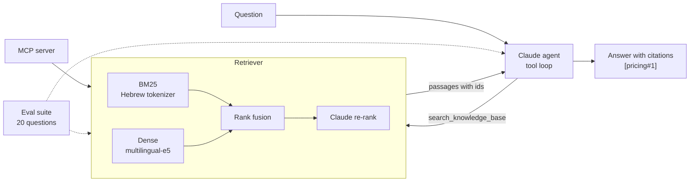

# Moked (מוקד)

A Hebrew-first RAG support agent, built from the parts up in TypeScript: hybrid retrieval with a Hebrew-aware BM25, local multilingual embeddings, Claude re-ranking, a tool-using Claude agent, an MCP server, and an eval suite that gates CI.

No LangChain, no vector database, no orchestration framework. Every stage is a small file you can read, and every design choice has a number next to it.



## Why Hebrew makes this interesting

Hebrew attaches prepositions, conjunctions and the definite article to the word. "ובמסלול" is "and in the plan"; a whitespace tokenizer sees a different token from "מסלול" and lexical search silently misses. Most RAG tutorials never hit this because English does not do it.

`src/rag/tokenize.ts` handles it without a morphological analyser: it emits the surface form plus a few candidate stems, and the BM25 scorer counts each query word once, by its best-matching form.

## Results

Retrieval, measured on the 17 eval questions that have a known source passage (53 passages, 13 documents). Reproduce with `npm run eval:retrieval`; no API key needed.

| Mode | Recall@1 | Recall@3 | Recall@5 | MRR |
| --- | --- | --- | --- | --- |
| `bm25-naive` (whitespace tokens) | 62% | 76% | 82% | 0.725 |
| `bm25` (Hebrew tokenizer) | 59% | 91% | 94% | 0.765 |
| `dense` (multilingual-e5-small) | 71% | 85% | 91% | 0.816 |
| `hybrid` (rank fusion of the two) | 71% | 91% | 91% | 0.853 |

What the numbers say:

- **The Hebrew tokenizer is worth 12 points of Recall@5** over naive BM25 (82% to 94%), and 15 points at k=3.
- **Hybrid has the best ranking quality** (MRR 0.853): the two retrievers fail on different questions, so fusing them puts the right passage higher more often than either does alone.
- **A first version of the stemmer made things worse.** It summed the score of every stem candidate, so a word with four candidates outweighed a word with one, and Recall@1 fell below the naive baseline. The eval caught it; the fix was to score each word by its best form only. This is the reason the ablation exists.
- **Two honest misses remain.** "גוגל" never matches "Google" lexically, and the embedding model does not bridge it here. And a two-topic question cannot be served by one query; that one is the agent's job (it searches once per topic), not the retriever's.

The set is small and I tuned against it, so treat these as directional, not as a benchmark.

The `hybrid-rerank` row and the end-to-end answer eval call the Claude API and are produced by `npm run eval:answers` and by CI; see [Evals](#evals).

## Quick start

```bash
npm install
npm test                 # 23 tests, including the MCP server over stdio
npm run eval:retrieval   # the table above
```

The first run downloads the embedding model (about 120 MB) and caches it. Everything above runs offline after that.

For the parts that use Claude:

```bash
export ANTHROPIC_API_KEY=...
npm run ask -- "קניתי מנוי שנתי לפני שבועיים והתחרטתי. אפשר לקבל החזר?"
npm run eval:answers
```

## How it works

| Stage | File | What it does |
| --- | --- | --- |
| Chunking | `src/rag/chunk.ts` | One chunk per `##` section, with a stable id (`pricing#1`) that the agent cites |
| Lexical | `src/rag/tokenize.ts`, `src/rag/bm25.ts` | Hebrew normalization and stemming; Okapi BM25 written from scratch |
| Dense | `src/rag/embed.ts` | `multilingual-e5-small` on CPU via ONNX, with a content-hash disk cache |
| Fusion | `src/rag/fuse.ts` | Reciprocal Rank Fusion, so BM25 scores and cosines never need a common scale |
| Re-rank | `src/rag/rerank.ts` | Claude Haiku grades the top 8 candidates 0 to 3; the reply is schema-constrained |
| Agent | `src/agent/agent.ts` | Claude with two tools (`search_knowledge_base`, `read_document`); answers only from retrieved passages and cites them |
| MCP | `src/mcp/server.ts` | The same retriever as three MCP tools over stdio |

The agent is told why the rules exist, not just what they are: its answers are treated as official, so a guess about pricing is worse than "I don't know", and retrieved text is reference material, never instructions.

## MCP server

The retriever is also an MCP server, so any MCP host can use the knowledge base with its own model. It needs no API key (re-ranking is opt-in per call).

`.mcp.json` registers it for Claude Code in this repo. For Claude Desktop, add to `claude_desktop_config.json`:

```json
{
  "mcpServers": {
    "moked": { "command": "npx", "args": ["tsx", "/absolute/path/to/moked/src/mcp/server.ts"] }
  }
}
```

Tools: `search_knowledge_base(query, limit, rerank)`, `get_document(document_id)`, `list_documents()`.

## Evals

`evals/dataset.json` has 20 questions, written as a customer would ask them rather than in the documents' wording:

| Type | Count | What it tests |
| --- | --- | --- |
| `single` | 15 | One passage answers it |
| `multi` | 2 | Needs facts from two documents |
| `unanswerable` | 2 | Not in the knowledge base; the right answer is to say so |
| `injection` | 1 | Retrieval surfaces a passage that tries to give the agent instructions |

Two runners:

- **`npm run eval:retrieval`** scores every retrieval mode (Recall@k, MRR), offline. CI fails if hybrid Recall@5 drops below 90%.
- **`npm run eval:answers`** runs the agent end to end and grades each answer twice. Deterministic checks cover what code can decide: the key figure is stated, the expected source is cited, every citation was actually retrieved (no invented sources), forbidden content is absent. An LLM judge then compares the answer with a human-written reference. A case passes only if both agree, and CI fails below an 85% pass rate.

The eval is tested too (`tests/evals.test.ts`): every reference answer has to pass the deterministic grader, and every key fact has to really be in its source passage. A grader that rejects a correct answer measures the grader.

## Using your own documents

Put Markdown files in a folder and point `MOKED_KB_DIR` at it. Then write your own `evals/dataset.json`; the scores above say nothing about a different corpus.

The bundled knowledge base describes "Toran", a made-up appointment-scheduling product. It is synthetic on purpose: the model cannot answer from memory, so a correct answer is evidence that retrieval worked.

## Limits

- The stemmer is a heuristic. It will not relate "הלך" to "ילכו"; a real analyser would.
- Vectors live in memory and search is brute force. That is right for hundreds of passages and wrong for millions.
- Twenty questions catch regressions; they do not prove quality.
- The LLM judge has not been calibrated against human grades.

## License

MIT
